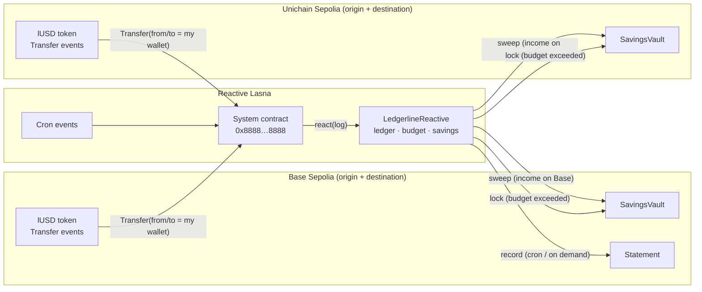
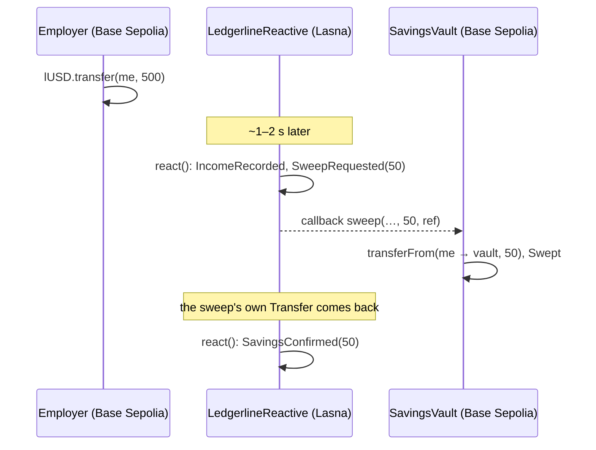

# Ledgerline

**One ledger for all your chains — and it runs itself.**

Ledgerline is a personal money tracker built on [Reactive Network](https://reactive.network). A single
reactive contract on Lasna watches your wallets' ERC-20 transfers on Base Sepolia and Unichain Sepolia,
keeps one cross-chain ledger, and acts on it:

| Rule | Trigger (origin) | Reactive logic (Lasna) | Callback (destination) |
| --- | --- | --- | --- |
| **Auto-save** | Income arrives in your wallet | 10% of it is earmarked | `SavingsVault.sweep` pulls it into savings **on the chain it arrived on** |
| **Budget guard** | You spend on *any* chain | Spending is summed across chains per UTC day | Over the limit → `SavingsVault.lock` freezes **every** vault until midnight |
| **Statements** | Reactive cron tick | Snapshot of every asset | `Statement.record` writes it to Base Sepolia |

There is no server, bot or keeper anywhere: every action starts from an on-chain event and ends in an
on-chain callback. Built for the [Reactive Omni Buildathon](https://dorahacks.io/hackathon/reactive-omni-buildathon/detail),
track **Set It and Forget It**.

> **Why it needs Reactive:** no contract on Base can see what you spent on Unichain. The cross-chain daily
> budget, and a lock that lands on every chain within seconds, only exist because a reactive contract
> sees all chains at once.

## Architecture



A typical loop, end to end:



### Subscriptions

For every tracked wallet *w* and token *t* on chain *c*, the reactive contract holds two subscriptions:

```
subscribe(c, t, Transfer, topic1 = w, *, *)   // money leaving w
subscribe(c, t, Transfer, *, topic2 = w, *)   // money arriving at w
```

Adding or removing a wallet or token (`trackWallet`, `untrackToken`, …) subscribes/unsubscribes exactly
those pairs at runtime. Filtering on the indexed wallet topic means you only pay for transfers that
involve you, and spam on the token never reaches the contract. Each log is de-duplicated by
`(chain, tx hash, log index)`, because a transfer between two of your own wallets matches two
subscriptions.

### Contracts

| Contract | Chain | Role |
| --- | --- | --- |
| [`LedgerlineReactive`](src/LedgerlineReactive.sol) | Lasna | Subscriptions, ledger, the three rules, callback requests |
| [`SavingsVault`](src/SavingsVault.sol) | Base Sepolia, Unichain Sepolia | `sweep` (opt-in via ERC-20 approval, replay-protected), `lock`, `withdraw` |
| [`Statement`](src/Statement.sol) | Base Sepolia | Stores the latest statement, emits every one, ignores out-of-order callbacks |
| [`LedgerToken`](src/LedgerToken.sol) | both | Mintable test stablecoin (lUSD, 6 decimals) for the demo |

Callback contracts inherit `AbstractCallback` and check both `onlyServiceProvider` (the chain's callback
proxy) and `onlyCallbackSender` (our reactive contract). Every callback payload reserves its first
argument for the reactive contract's address, which the network injects.

## Deployments (Lasna + testnets)

| | Address |
| --- | --- |
| LedgerlineReactive (Lasna) | `TBD` |
| SavingsVault (Base Sepolia) | `TBD` |
| Statement (Base Sepolia) | `TBD` |
| lUSD (Base Sepolia) | `TBD` |
| SavingsVault (Unichain Sepolia) | `TBD` |
| lUSD (Unichain Sepolia) | `TBD` |

## Proof: full loops on-chain

| Loop | Origin tx | Reactive tx (Lasna) | Callback tx | Latency |
| --- | --- | --- | --- | --- |
| Auto-save on Base | `TBD` | `TBD` | `TBD` | TBD |
| Auto-save on Unichain | `TBD` | `TBD` | `TBD` | TBD |
| Budget lock (spend on Base → lock Unichain vault) | `TBD` | `TBD` | `TBD` | TBD |
| Statement | `TBD` | — | `TBD` | TBD |

Latency is measured by [`script/e2e.py`](script/e2e.py) from the origin block timestamp to the callback
block timestamp, and separately by wall clock. Raw results: [`deployments/e2e-latest.json`](deployments/e2e-latest.json).

## Run it yourself

Requirements: [Foundry](https://getfoundry.sh), Python 3, testnet ETH on Ethereum Sepolia (bridge some
to Base/Unichain Sepolia; send some to the [Reactive faucet](https://dev.reactive.network/reactive-mainnet#get-testnet-react)
for lREACT).

```bash
git clone --recursive <this repo> && cd ledgerline
forge test                        # 63 unit/integration tests with a mocked system contract
cp .env.example .env              # point KEY_FILE / PRIVATE_KEY at a testnet-only key
./script/deploy.sh                # deploys to Lasna, Base Sepolia, Unichain Sepolia and wires it up
python3 script/e2e.py             # fires real transactions and records every loop + latency
python3 -m http.server 8000       # then open http://localhost:8000/dashboard/
```

### Costs (testnet)

| | Per event | Notes |
| --- | --- | --- |
| Reactive tx on Lasna | ~0.03 lREACT | (gas used + 100k) × 100 gwei; worst case `react()` ≈ 245k gas |
| Callback on Base / Unichain | < 0.00001 ETH | billed to the callback contract in native ETH |
| Cron | ~0.02 lREACT per tick | Cron1000 ≈ every 17 min; use Cron10000 (~3 h) for daily statements |

## Tests

```bash
forge test -vv
forge coverage --ir-minimum
```

The suite etches a mock system contract at `0x8888…8888` and delivers callbacks through a mock proxy
that injects the sender address like the real one. It covers every rule path (spend, income, sweep,
dust, internal moves, duplicate logs, cross-chain budget, once-per-day lock, midnight reset, 80% warning,
cron schedule, statements), access control on every function, payment/debt handling, and a gas check that
the worst-case `react()` stays far below the network's 900k cap.

## Limitations and next steps

- One owner per deployment (it is a *personal* tool). A factory could deploy one per user.
- Daily budgets use UTC days. Time zones could be a per-asset offset.
- Savings stay on the chain they were earned on; there's no bridging.

## License

MIT
